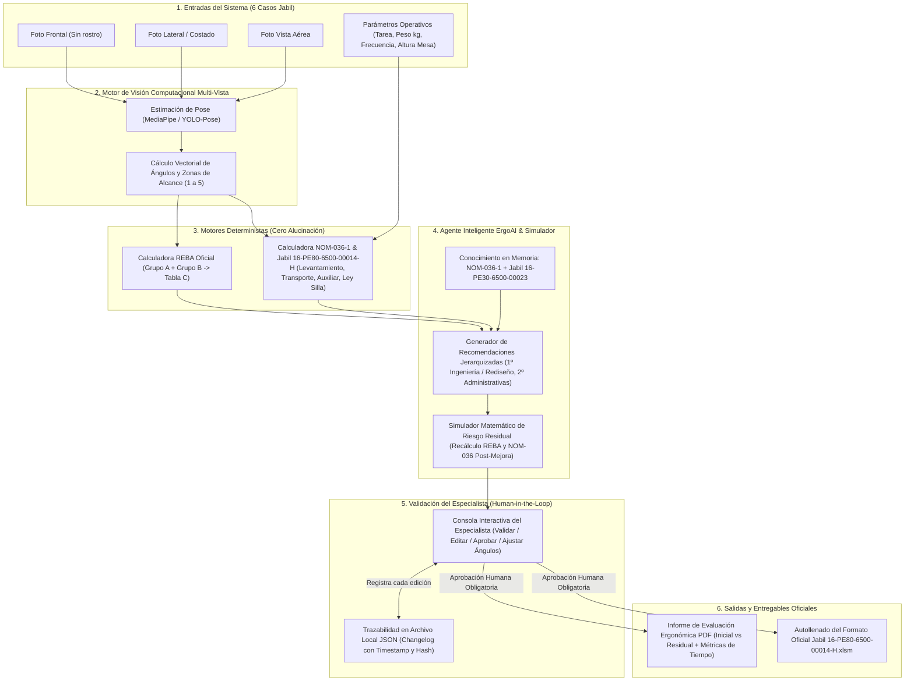

# Especificaciones Integrales del Proyecto: ErgoAI - Asistente Inteligente y Validación de Evaluaciones Ergonómicas (Track 4 - Jabil)

Este documento integra de manera exhaustiva todas las especificaciones técnicas, metodológicas, operativas, normativas y de arquitectura exigidas y demostradas a través del análisis secuencial de los tres formatos oficiales del proyecto:
1. **Formato 1 (`16-PE80-6500-00014-H.xlsm`)**: Herramienta oficial de Jabil para Evaluación de Ergonomía en Ingeniería de Procesos (NOM-036-1-STPS-2018 / MAC, RULA/REBA, EAWS, Antropometría).
2. **Formato 2 (`16-PE30-6500-00023.pdf`)**: Instrucción de Trabajo de Administración y Control de Layouts (Estándares de diseño de estación, distancias de alcance, alturas, Ley Silla, límites de carga, ruteos y aprobaciones MOC).
3. **Formato 3 (`Rúbrica de evaluación_ ErgoAI.pdf`)**: Lineamientos, reglas, casos de prueba, criterios de calificación (100 pts) y restricciones del Track 4 en X-RAIC 2026.

---

## 1. Análisis Secuencial y Exhaustivo por Formato

### 1.1 Análisis del Formato 1: `16-PE80-6500-00014-H (1).xlsm` (Evaluación de Ergonomía)
El archivo es un libro habilitado para macros compuesto por **10 hojas interconectadas** que digitalizan la evaluación ergonómica integral de una estación de manufactura:

*   **Hoja 1: `Mov` (Análisis de Estación, Fuerza, Postura y Ambiente)**
    *   **Metadatos de Cabecera**: Negocio, Línea, Área, Fecha (`dd/mmm/aaaa`), Modelo y Realizado por.
    *   **Sección A (Zonas de Alcance de Material)**: Evalúa en qué cuadrantes (Izquierda 1 a 4, Derecha 1 a 4) y a qué frecuencia (`<1/min`, `1-5/min`, `5-15/min`, `>15/min`) el operador toma materiales respecto a una mesa estándar de `970 mm` de altura.
    *   **Sección B (Área de Trabajo y Antropometría)**: Clasifica la estación en *Sentado (S)*, *De Pie (P)* o *Combinado*. Valida parámetros críticos:
        *   Espacio para los pies (Pie): `>= 15 cm` de profundidad.
        *   Tapete antifatiga (Pie): `Sí / No`.
        *   Altura de reposapiés (P/S): `> 21 cm y < 37 cm`.
        *   Profundidad de reposapiés (P/S): `15 cm ± 2 cm`.
        *   Altura de área de trabajo: Cruza el tipo de tarea (*Precisión*: 95-120 cm; *Ligero*: 85-110 cm; *Pesado/Esfuerzo*: 65-95 cm) con el tiempo de exposición (`<= 4 hrs` o `> 4 hrs`) y rangos de altura (`95-120 cm`, `120-130 cm`, `<95 o >130 cm`).
        *   Espacio para piernas sentado: Profundidad `> 55 cm`, Ancho `> 60 cm`.
        *   Espacio para el asiento: `> 30 cm`.
        *   Espesor de la mesa de trabajo: `< 10 cm`.
    *   **Sección C (Análisis de Fuerza Biomecánica)**: Convierte la masa en `kg` o `lb` a Newtons (`Nw = kg * 9.80665`). Evalúa 13 tipos de acción/postura (agarre de potencia con una mano, trabajo con brazo sentado arriba/abajo/afuera/adentro, empujar/jalar con o sin soporte de tronco, empujar/jalar de pie, uso de pedal con talón o pierna) ponderados por factores de:
        *   *Velocidad de movimiento*: Inmovilidad/muy lento (`1.0`), Movimiento apreciable (`0.8`).
        *   *Duración*: `< 3 seg` (`1.0`), `> 3 seg` (`0.8` a `0.5`).
        *   *Frecuencia (acciones/min)*: `<= 0.2` (`1.0`), `0.2 - 2` (`0.8`), `2 - 20` (`0.5`), `> 20` (`0.3`).
        *   *Duración de la tarea (Horas)*: `<= 1 h` (`1.0`), `1 - 2 h` (`0.8`), `> 2 h` (`0.5`).
        *   *Fórmula de Factor de Fuerza*: `ROUNDUP(Fuerza_Nw / (Capacidad_Base * Factor_Vel * Factor_Dur * Factor_Frec * Factor_Horas), 2)`.
    *   **Sección D (Evaluación Postural por Grupos A y B - RULA / REBA)**:
        *   *Grupo A*: Puntuación de Brazo (1 a 6), Antebrazo (1 a 3), Muñeca (1 a 4) y Giro de Muñeca (1 a 2), más Actividad Muscular y Carga/Fuerza.
        *   *Grupo B*: Puntuación de Cuello (1 a 6), Tronco (1 a 6) y Piernas (1 a 4), más Actividad Muscular y Carga/Fuerza.
        *   Contiene las matrices de cruce mediante concatenación de códigos (ej. `=CONCATENATE(L99,L107,L116,L125)`) para obtener la puntuación final y el Nivel de Riesgo (`1 a 4` -> Verde `V`, Amarillo `A`, Rojo `R`). *Nota técnica del archivo*: En la celda `BH169` existe una nota interna de ingeniería: `"cambiar formula y quitar puntos 4 y 5 de piernas"`, lo que evidencia la transición y ajuste entre RULA/REBA dentro de Jabil.
    *   **Sección E (Accesibilidad)**: Evalúa acceso al área (`>= 800 mm`), distancia entre dos operadores (`>= 800 mm`) y libertad de miembros superiores e inferiores (`1` = Fácil, `5` = Obstaculizado).
    *   **Sección F (Visual - Señalización)**: Evalúa distancia mínima a ayuda visual (`>= 40 cm`) y altura de visualización (`1400 - 1600 mm` óptimo = 1 pto; `1200-1400` o `1600-1900 mm` = 3/5 ptos).
    *   **Sección G (Iluminación)**: Evalúa luxes según actividad:
        1. Empaque / oficinas: `300 lux`.
        2. Laboratorios, maquinado y ensamble: `500 lux`.
        3. Ensambles de precisión, piezas pequeñas: `750 lux`.
        4. Alta distinción de detalles, OBA / inspección con lupa: `1000 lux`.
    *   **Sección H (Evaluación Subjetiva del Operador)**: Escala del 1 al 5 (`1` = Muy bien [Verde], `2` = Bien, `3` = Algunas mejoras [Amarillo], `4` = Molesto, `5` = Muy doloroso: espalda, cuello, hombros, piernas, manos, muñecas [Rojo]).

*   **Hojas 2, 3, 4, 5 y 6: Evaluación de Manejo Manual de Cargas (Apéndice I y II de la NOM-036-1-STPS-2018 / Metodología MAC & RAPP)**
    *   Cada hoja evalúa un escenario específico mediante bandas de color (**Verde / Bajo**, **Naranja / Medio**, **Rojo / Alto**, **Morado / Muy Alto**):
        *   **`Levantamiento (1)`**: Factores `a)` Peso vs Frecuencia (`0, 4, 6, 10` ptos), `b)` Distancia horizontal manos-espalda baja (`0, 3, 6` ptos), `c)` Región de levantamiento vertical (`0, 1, 3` ptos), `d)` Torsión y flexión lateral del torso (`0, 1, 2` ptos), `e)` Restricciones posturales (`0, 1, 3` ptos), `f)` Acoplamiento mano-carga (`0, 1, 2` ptos), `g)` Superficie de trabajo (`0, 1, 2` ptos), `h)` Factores ambientales: temperatura, aire, iluminación (`0, 1, 2` ptos).
        *   **`Transporte (2)`**: Mismos factores base pero reemplaza región vertical por `c)` Carga asimétrica sobre el torso (`0, 1, 2, 3` ptos) y añade `h)` Distancia de transporte (`0, 1, 3` ptos) y `j)` Obstáculos en la ruta / escaleras (`0, 1, 3` ptos).
        *   **`Equipo (3)` (Levantamiento entre 2 a 4 personas)**: Incluye `a)` Peso según número de operadores (`0, 4, 6, 10` ptos) y añade el factor `i)` Comunicación, coordinación y control (`0, 1, 3` ptos).
        *   **`sin auxiliar (4)` (Empuje y Arrastre sin equipo - Rodando, Girando sobre base, Arrastrando/Deslizando)**: Evalúa `a)` Actividad y peso (`0, 2, 4, 8` ptos), `b)` Postura (`0, 3, 6` ptos), `c)` Agarre de la mano (`0, 1, 2` ptos), `d)` Patrón de trabajo (`0, 1, 3` ptos), `e)` Distancia por viaje (`0, 1, 3` ptos), `f)` Superficie (`0, 1, 4` ptos), `g)` Obstáculos (`0, 2, 3` ptos), `h)` Otros factores (`0, 1, 2` ptos).
        *   **`con auxiliar (5)` (Empuje y Arrastre con equipo: Pequeño 1-2 ruedas, Mediano 3+ ruedas, Grande/rieles)**: Evalúa `a)` Tipo de equipo y peso (`0, 2, 4, 8, 21` [Inaceptable si excede capacidad nominal]), `b)` Postura (`0, 3, 6` ptos), `c)` Acoplamiento (`0, 1, 2` ptos), `d)` Patrón (`0, 1, 3` ptos), `e)` Distancia (`0, 1, 3` ptos), `f)` Condición de mantenimiento del equipo auxiliar (`0, 2, 4` ptos), `i)` Superficie (`0, 1, 4` ptos), `j)` Obstáculos (`0, 2, 3` ptos), `k)` Otros factores (`0, 1, 2` ptos).

*   **Hojas 7, 8, 9 y 10: Consolidación, Plan de Acción, Evidencia y EAWS**
    *   **`Resultado`**: Consolida todas las banderas y puntajes de `Mov` y de las 5 hojas de cargas para emitir el dictamen por sección.
    *   **`OBSERVACIONES Y MEJORAS`**: Registro de trazabilidad de planes de acción (`# Evaluación`, `Identificador/Inciso`, `Problema/Descripción`, `Solución - Mejoras/Plan`, `Responsable/Dueño de la acción`, `Fecha compromiso`).
    *   **`Fotos de la estacion`**: Lienzo para insertar evidencia fotográfica de la estación evaluada.
    *   **`EAWS`**: Evaluación simplificada de carga postural de tronco:
        *   `Puntaje Postura` = `IF(Flexión<20°, 1, IF(Flexión<45°, 3, 6)) + IF(Torsión<20°, 0, 2) + (Trabajo_Sobre_Hombro * 2) + (Trabajo_Bajo_Rodilla * 2)`.
        *   `Puntaje Fuerza` = `IF(Fuerza_kg<5, 1, IF(Fuerza_kg<10, 3, 6))`.
        *   `Puntaje Frecuencia` = Basado en acciones por turno (`<100` -> 1; `<500` -> 3; `>=500` -> 6).
        *   `Nivel de Riesgo EAWS` = `<= 5` (**Bajo**), `6 - 10` (**Medio**), `> 10` (**Alto**).

---

### 1.2 Análisis del Formato 2: `16-PE30-6500-00023 (1).pdf` (Instrucción de Trabajo: Administración y Control de Layouts)
Este documento oficial de Jabil Chihuahua establece las reglas físicas, ergonómicas y de ingeniería de planta que toda recomendación de rediseño de estación debe respetar:

*   **Límites Estrictos de Carga Manual (Sección 6.4)**:
    *   **Límite máximo individual en Jabil Chihuahua**: **14 kg** por una sola persona. Si supera 14 kg, es **obligatorio** considerar asistencia mecánica (lifter, grúa, brazo).
    *   **Levantamiento en equipo (Solo como contención temporal con MOC y evaluación `16-PE80-6500-00014`)**:
        *   Nivel Verde (Valor 0): 2 personas `< 19 kg` | 3 personas `< 23 kg`.
        *   Nivel Naranja (Valor 4 - Requiere validación médica de condición física óptima): 2 personas `>= 19 y < 28 kg` | 3 personas `>= 23 y < 42 kg` | 4 personas `>= 23 y < 56 kg`.
    *   **Espacio libre para levantamiento**: Mínimo **60 cm libres** sin obstáculos que obliguen a inclinarse.
    *   **Alturas máximas de toma de material (sin escaleras)**: En racks estáticos máximo **1.70 m**; en tarimas o carros máximo **1.60 m**. Se debe evitar levantar desde el nivel del piso o por encima de la cabeza.

*   **Diseño de Estación, Bipedestación y "Ley Silla" (Secciones 7.2 y 7.3)**:
    *   **Criterio Sentado vs. De Pie**:
        *   *Recomendar Sentado si*: Todos los objetos están dentro del alcance, los objetos pesan **menos de 3 kg**, son tareas de **ensamblado fino**, o se requiere usar **pedales**.
        *   *Recomendar De Pie si*: Se manejan objetos de **más de 3 kg**, o las operaciones están separadas físicamente y requieren movimientos frecuentes.
    *   **Cumplimiento de la Ley Silla (STPS)**:
        *   Se evalúan 7 factores (tiempo de pie continuo, posibilidad de cambiar postura, espacio para moverse, malestares reportados, tipo de superficie/tapete, pausas/tareas alternas, calzado).
        *   **Regla de las 3 horas**: Evitar más de **3 horas continuas de bipedestación**, sentando al operador al menos **5 minutos** (el uso del baño *no* cuenta para romper bipedestación; el comedor en hora de comida *sí* cuenta).
        *   **Dos estrategias válidas**: (1) Agregar silla de descanso por 5 min con relevo cubriendo la operación y rol de turnos definido; (2) Rotar personal entre estaciones de pie y estaciones sentadas (con análisis ergonómico y aprobación del supervisor).
        *   La ubicación de la silla debe marcarse en el piso con la leyenda `"SILLA"` / `"CHAIR"`, incluirse en el layout CAD y en la fábrica visual sin obstruir pasillos.
    *   **Zonas de Alcance en la Estación (Sección 7.2.2.2 - en milímetros)**:
        *   **Posiciones 1 y 2 (Radio 150 mm a 400 mm / ángulo 20°-35°)**: Uso obligatorio para todo herramental y material que se utiliza **regularmente** en cada ciclo.
        *   **Posición 3 (Radio 400 mm a 650 mm)**: Permitido únicamente cuando la frecuencia de uso es **menor a una vez por pieza**.
        *   **Posiciones 4 y 5 (Radio > 650 mm a 1500 mm)**: Áreas **fuera del alcance del operador**. Si existe material de trabajo ahí, es obligatorio reubicarlo a las Posiciones 1 y 2.
    *   **Dimensiones Antropométricas de Estación (Site CUU - Sección 7.2.3 y 7.3.3)**:
        *   Altura de área de trabajo recomendada: **95 cm a 125 cm**.
        *   Distancia mínima entre operadores: **80 cm** (medidos de punto medio a punto medio de cada persona).
        *   Espacio libre para piernas (sentado): Mínimo **55 cm de profundidad** y **60 cm de ancho**.
        *   Espacio libre para pies (de pie): Mínimo **15 cm de profundidad** para acercarse a la mesa.
        *   Reposapiés (pie o sentado): Altura entre **21 cm y 37 cm**, y **15 cm hacia atrás** desde el borde.
        *   Espesor máximo del borde de la mesa: **<= 10 cm** (evitar estrés por contacto).
        *   Silla estándar: 5 patas, aro reposapiés, altura ajustable, respaldo no rígido, material poliuretano, y **obligatoriamente ESD** en áreas EPA.
    *   **Uso de Conveyors (Sección 7.3.3.2)**:
        *   Altura permitida: Mínima **0.50 m (50 cm)** y máxima **1.40 m (140 cm)**.
        *   Conveyors eléctricos requieren guardas en engranes, motores y poleas.
        *   Conveyors de gravedad: **Prohibidos en distancias mayores a 3 metros**.
        *   Acceso libre alrededor del conveyor: Mínimo **80 cm**.
        *   Evitar inspecciones visuales directas sobre el conveyor en movimiento.

*   **Pasillos, AMRs, Balanceo y Controles Administrativos/Ingeniería (Secciones 6.2, 6.3, 7.1, 7.5)**:
    *   **Métricas de Proceso**: LBR (Line Balance Rate) `>= 85%`; Cuello de botella `<= 95% del Takt Time`; Máximo **3 áreas de WIP** por línea; Layout Accuracy `>= 90%`.
    *   **Anchos de Pasillos**:
        *   Dentro de Backend (BE): Flujo peatonal constante `1.20 m - 1.80 m`; Flujo solo personal del área `0.50 m - 1.40 m`; Flujo de material mínimo **90 cm (0.90 m)**.
        *   Entre líneas: Peatonal con carros ligeros `0.90 m - 1.20 m`; Peatonal con carros y tarimas `1.50 m`.
        *   Pasillos AMR: Unidireccional = `Ancho AMR/Carga + 0.50 a 0.60 m` (`0.25-0.30 m` por lado); Bidireccional = `AMR1 + AMR2 + Espacio cruce (0.25-0.30 m) + 2*(0.25-0.30 m)`.
        *   Separación mínima entre tarima y mesa de trabajo: **30 cm**.
        *   Área libre frente a tableros eléctricos: **90 cm**.
    *   **Capas (Layers) Oficiales de AutoCAD**: `Servicios` (Azul-150 `RGB 0,127,255` - en texto, no dibujo), `Equipos`, `Mobiliario`, `WIP`, `Columnas` (bloqueado), `Columnas-text` (Azul-160 `RGB 0,63,255`, bloqueado), `Pasillos` (Amarillo `RGB 255,255,0`), `Cotas`.
    *   **Ruteo de Cables y Bajadas**: Bajadas a `90°` exactos; contactos eléctricos a `30 cm` del piso; cable de red sujeto **únicamente con Velcro** (`IT03-2502`); mangueras de aire con corbatas plásticas (`EV05-0782`); cables ocultos en canaleta PVC sin plomo (`EV05-1001`) o tubing (`EG01-0007`).
    *   **Gobernanza y MOC**: Cualquier cambio físico en estación o layout requiere el flujo `16-PE00-6500-00014`, checklist `16-PE80-6500-00040`, presentación `16-PE80-6500-00046` y el **MOC firmado (`16-HS80-8000-00021`)** por EHS antes de instalar servicios.

---

### 1.3 Análisis del Formato 3: `Rúbrica de evaluación_ ErgoAI (Track 4).pdf`
Define las reglas exactas del reto competitivo para el desarrollo del agente inteligente **ErgoAI**:

*   **Objetivo Central**: Desarrollar un prototipo funcional de un agente inteligente de ergonomía que evalúe la postura de un operador a partir de **fotografías de la estación (frente, costado y vista aérea, sin rostros)** y genere un **informe de evaluación ergonómica con recomendaciones de mejora** basadas en la **NOM-036-1-STPS-2018** y los estándares de Jabil.
*   **Metodología Principal Exigida**:
    *   **Método REBA (Rapid Entire Body Assessment)** como método primario obligatorio para evaluar la postura a partir de los ángulos articulares extraídos de las fotografías, tomando como referencia el estudio ergonómico de ángulos de apertura definido por Jabil.
    *   Los demás métodos (**NOM-036-1 MAC/RAPP, RULA, EAWS, Ley Silla, Antropometría de `16-PE80-6500-00014-H`**) actúan como **complemento directo** para resolver los 6 casos integrales.
*   **Los 6 Casos de Prueba Oficiales de Jabil**:
    *   Cubren obligatoriamente tres categorías operativas (con al menos un caso de cada una):
        1. **Levantamiento de cargas** (vinculado a Hoja `Levantamiento (1)` y `Equipo (3)`).
        2. **Transporte con equipo auxiliar** (vinculado a Hoja `con auxiliar (5)`).
        3. **Transporte sin equipo auxiliar** (vinculado a Hoja `Transporte (2)` y `sin auxiliar (4)`).
*   **Jerarquía de Controles y Recomendaciones**:
    *   Prioridad estricta en **Controles de Ingeniería y Rediseño Físico de la Estación** (ajustar alturas de mesa entre 95-125 cm, acercar materiales de zonas 4/5 a zonas 1/2, integrar lifters si `>14 kg`, cambiar herramienta por una ergonómica, alternar postura sentado/de pie si `<3 kg`) por encima de medidas administrativas (rotación de turnos, pausas, capacitación).
*   **Human-in-the-Loop (Validación del Especialista) y Trazabilidad**:
    *   *"El agente propone y el especialista decide"*: El sistema debe incluir una interfaz y flujo donde el ingeniero especialista pueda **validar, editar o aprobar** cada recomendación antes de emitirla como acción de piso, guardando un **registro de auditoría (changelog)** de cada modificación.
*   **Cálculo de Riesgo Residual e Impacto**:
    *   El sistema debe **recalcular automáticamente el puntaje REBA / NOM-036 esperado (Riesgo Residual)** simulando cómo quedarían los ángulos y factores tras aplicar las recomendaciones de ingeniería, comparando el *Antes vs. Después*.
    *   Debe medir cuantitativamente el impacto en reducción de tiempos de evaluación y redacción de informes.
*   **Restricción Arquitectónica Crítica**:
    *   *"El equipo no genera una base de datos: solo implementa el método para evaluar la postura"*. Toda la persistencia de sesiones, trazabilidad de cambios y generación de reportes debe manejarse en memoria o mediante archivos estructurados locales (`.json`, `.yaml`, `.md`, `.pdf`, `.xlsx`) sin requerir motores de bases de datos relacionales o NoSQL externos.
*   **Estructura de Evaluación (100 Puntos)**:
    1. *Puntaje REBA y nivel de riesgo exacto vs. Jabil (6 casos)*: **20 pts** (Criterio 1 de desempate).
    2. *Estimación de ángulos articulares (`>= 90%` en rango REBA)*: **15 pts** (Criterio 2 de desempate).
    3. *Informe y recomendaciones jerarquizadas (NOM-036 + Controles de Ingeniería)*: **15 pts** (Criterio 3 de desempate).
    4. *Diseño del agente y arquitectura modular verificable*: **8 pts**.
    5. *Originalidad y diferenciación frente a calculadoras genéricas*: **7 pts**.
    6. *Validación del especialista (Human-in-the-loop) y registro de cambios*: **6 pts**.
    7. *Recálculo y comparación del Riesgo Residual*: **4 pts**.
    8. *Medición de impacto en tiempos de respuesta con datos de prueba*: **5 pts**.
    9. *Documentación técnica (`<= 10 cuartillas`, entrega límite: 9 de noviembre de 2026, 9:00 AM)*: **10 pts**.
    10. *Pitch y demostración en vivo (1 min setup + 6 min demo + 3 min Q&A)*: **10 pts**.

---

## 2. Lo que Explícitamente se Prohíbe o No se Debe Hacer (Anti-Patrones y Restricciones)

### 2.1 Prohibiciones Técnicas y de Competencia (Rúbrica Track 4)
1.  **PROHIBIDO implementar o depender de un motor de Base de Datos (SQL / NoSQL)**: La rúbrica especifica explícitamente: *"El equipo no genera una base de datos: solo implementa el método para evaluar la postura"*. No se debe levantar SQL Server, PostgreSQL, MySQL, MongoDB ni SQLite como requisito del sistema.
2.  **PROHIBIDO emitir recomendaciones finales sin validación humana (Human-in-the-Loop)**: Ninguna recomendación generada por la IA puede convertirse en acción de piso ni exportarse como informe definitivo sin pasar por el módulo de revisión, edición y aprobación del especialista con registro de trazabilidad (penalización directa en el Criterio 6).
3.  **PROHIBIDO limitar las recomendaciones a Medidas Administrativas en casos de Riesgo Alto o Muy Alto**: Proponer únicamente "capacitar al operador", "dar pausas" o "rotar personal" cuando el riesgo es Alto/Muy Alto impide obtener el puntaje máximo en el Criterio 3. Siempre deben proponerse primero **Controles de Ingeniería y Rediseño de Estación**.
4.  **PROHIBIDO omitir el cálculo matemático del Riesgo Residual**: Mencionar el riesgo residual de forma descriptiva sin recalcular el nuevo puntaje REBA / NOM-036 esperado y compararlo contra el inicial penaliza el Criterio 7.
5.  **PROHIBIDO usar rostros o datos biométricos faciales**: Las fotografías de entrada no contienen rostros y el sistema no debe requerir detección facial ni almacenar identificadores biométricos personales.
6.  **PROHIBIDO compartir los activos de Jabil fuera del equipo**: Las imágenes y casos de prueba de Jabil son confidenciales y exclusivos para la competencia.
7.  **PROHIBIDO exceder las 10 cuartillas en la documentación técnica** o entregarla después del lunes 9 de noviembre de 2026 a las 9:00 AM.

### 2.2 Prohibiciones de Ingeniería de Planta, Ergonomía y Layout (Estándares Jabil)
1.  **PROHIBIDO el levantamiento manual individual superior a 14 kg**: En Jabil Chihuahua ninguna persona puede cargar más de `14 kg` sin asistencia mecánica.
2.  **PROHIBIDO mantener materiales de uso regular en las Zonas 4 y 5 (`> 650 mm`)**: Ningún componente o herramienta de ciclo continuo puede ubicarse fuera de las zonas 1 y 2 (`150 - 400 mm`).
3.  **PROHIBIDO levantar cargas desde el nivel del piso o por encima de la cabeza**: El límite superior sin escaleras es `1.70 m` en racks estáticos y `1.60 m` en carros/tarimas.
4.  **PROHIBIDO exceder 3 horas continuas de bipedestación sin descanso (Ley Silla)**: Y está **prohibido contabilizar las salidas al baño** como interrupción de bipedestación.
5.  **PROHIBIDO fijar sillas al piso con cadenas o materiales no autorizados**: Requiere validación previa de EHS y Facilities.
6.  **PROHIBIDO usar conveyors de gravedad mayores a 3 metros de longitud**, o conveyors con alturas `< 0.50 m` o `> 1.40 m`.
7.  **PROHIBIDO colocar áreas de cartón junto a líneas SMT** (riesgo de contaminación por partículas).
8.  **PROHIBIDO instalar equipos en pasillos, bloquear tableros eléctricos (requieren `90 cm` libres al frente), extintores, hidrantes o rutas de evacuación**.
9.  **PROHIBIDO usar la misma canaleta plástica para más de una estación**, doblar/arquear canaletas, dejar que cables/tubing toquen el piso, usar corbatas plásticas en cables de red dentro de tubos eléctricos (solo se permite Velcro), o hacer bajadas de servicios que no estén a `90°` exactos.
10. **PROHIBIDO ejecutar instalaciones físicas de IT o Facilities sin tener el MOC (`16-HS80-8000-00021`) firmado por EHS**.

---

## 3. Arquitectura Sugerida del Proyecto (3 Capas: Backend, Frontend y Persistencia Sin BD)

Dado que el proyecto exige alta precisión en visión computacional (estimación de ángulos articulares en 3 vistas: frontal, lateral y aérea), exactitud determinista en los métodos **REBA** y **NOM-036-1 / Jabil `16-PE80-6500-00014-H`**, generación inteligente de recomendaciones con IA, validación *Human-in-the-Loop* con trazabilidad, y **ausencia total de base de datos**, se propone una **Arquitectura Modular Desacoplada Basada en Estado en Memoria y Almacenamiento de Sesiones JSON/Archivos (Stateless Engine + File-Based Audit Trail)**.

### 3.1 División en 3 Puntos Clave

#### Punto 1: Backend (Motor de Visión, Reglas Deterministas y Agente IA)
*   **Lenguaje Sugerido**: **Python 3.11+** (ecosistema líder e indiscutible para Visión Computacional, cálculo científico y orquestación de Agentes LLM).
*   **Framework API**: **FastAPI** (asíncrono, tipado estricto con Pydantic, autogeneración de OpenAPI y altísima velocidad de respuesta para la demo de 6 minutos).
*   **Módulos Internos del Backend**:
    1.  **Módulo de Visión Computacional Multi-Vista (`vision_engine`)**:
        *   **MediaPipe Pose Heavy / YOLOv11-Pose + OpenCV**: Extracción de 33 keypoints 3D/2D en las vistas **Frontal** (abducción de hombro, inclinación lateral de tronco/cuello, asimetría), **Lateral/Costado** (flexión/extensión de cuello, tronco, hombro, codo, muñeca y rodilla) y **Aérea/Superior** (rotación/torsión de tronco, ángulo de apertura y zona de alcance en mesa `1 a 5` en mm).
        *   **Geometría Vectorial (`NumPy` / `SciPy`)**: Cálculo exacto de ángulos mediante producto punto en planos anatómicos proyectados y calibración de homografía para estimar distancias horizontales manos-espalda baja (`cm`) y zonas de alcance (`150 mm - 1500 mm`).
    2.  **Motor Determinista de Evaluación Ergonómica (`ergo_calculators`)**:
        *   *Nota crítica*: **Nunca dejar que un LLM calcule puntajes REBA o NOM-036 por su cuenta** (evita alucinaciones y garantiza 20/20 pts en el Criterio 1 y 15/15 pts en el Criterio 2).
        *   **Calculadora REBA Exacta (`reba_engine.py`)**: Tablas oficiales A, B y C codificadas de forma determinista con los umbrales de ángulo de Jabil, ajustes por abducción, rotación, acoplamiento, carga y actividad muscular.
        *   **Calculadora NOM-036-1 & Jabil XLSM (`nom036_jabil_engine.py`)**: Réplica exacta en código Python de las fórmulas de las hojas `Mov`, `Levantamiento (1)`, `Transporte (2)`, `Equipo (3)`, `sin auxiliar (4)`, `con auxiliar (5)` y `EAWS` del archivo `16-PE80-6500-00014-H.xlsm`, además de las reglas de `16-PE30-6500-00023.pdf` (límite 14 kg, Ley Silla, alturas 95-125 cm).
        *   **Simulador de Riesgo Residual (`residual_risk_simulator.py`)**: Función matemática que proyecta la corrección de ángulos (ej. llevar flexión de tronco de `48°` a `10°` al elevar la mesa a `105 cm`, o reducir carga efectiva a `0 kg` con lifter) y recalcula automáticamente el **REBA Residual** y **NOM-036 Residual**.
    3.  **Agente Inteligente de Recomendaciones (`ai_agent`)**:
        *   Orquestado con **LangChain / LangGraph** o SDK nativo (compatible con modelos locales vía **Ollama / Llama-3.1 / Qwen-2.5** por si hay restricción de red externa en Jabil, o API de **Gemini 2.5 Pro / OpenAI** con *Structured Outputs*).
        *   Alimentado mediante **RAG Estático en Memoria** con los fragmentos normativos exactos de la **NOM-036-1-STPS-2018** y el manual de layouts **Jabil `16-PE30-6500-00023`**.
        *   Genera recomendaciones estrictamente jerarquizadas: **1º Controles de Ingeniería (Rediseño físico/herramental)** -> **2º Controles Tecnológicos/Auxiliares** -> **3º Controles Administrativos (Ley Silla / Rotación)**.
    4.  **Generador de Entregables Oficiales (`report_exporter`)**:
        *   Genera el **Informe PDF Ejecutivo** (`WeasyPrint` / `ReportLab`) con esqueletos superpuestos, tablas comparativas de Riesgo Inicial vs. Riesgo Residual y firmas de validación.
        *   Autopopula con `openpyxl` una copia real del archivo oficial de Jabil **`16-PE80-6500-00014-H.xlsm`** listo para entregar a Ingeniería de Procesos.

#### Punto 2: Frontend (Panel Interactivo de Evaluación y Validación Human-in-the-Loop)
*   **Lenguaje y Framework Sugerido**: **TypeScript + Vue 3 (Vite + Pinia + TailwindCSS)** *(o React/Next.js)*. Vue 3 permite construir un dashboard reactivo sumamente rápido, limpio y modular.
*   **Vistas y Componentes Principales**:
    1.  **Selector de los 6 Casos y Carga Multi-Vista**: Carga simultánea de las 3 fotografías (*Frente*, *Costado*, *Aérea*) y selección del tipo de operación (*Levantamiento*, *Transporte con Auxiliar*, *Transporte sin Auxiliar*) y metadatos básicos (peso en kg, frecuencia, altura actual de mesa).
    2.  **Visor Anatómico Interactivo (Canvas HTML5 / Konva.js)**: Muestra las 3 fotos con el esqueleto superpuesto, los ángulos medidos en cada articulación codificados por color (Verde, Amarillo, Rojo) y permite al especialista **ajustar manualmente un keypoint** si hubiera oclusión visual en la foto, recalculando REBA en tiempo real.
    3.  **Dashboard de Diagnóstico Dual (REBA + NOM-036 / Jabil)**: Muestra Puntaje Grupo A, Grupo B, Tabla C, Puntaje REBA Final, Nivel de Riesgo, Cumplimiento de Ley Silla y alertas del estándar Jabil (`>14 kg`, zonas de alcance `4 y 5`).
    4.  **Consola de Validación del Especialista (Human-in-the-Loop & Audit Log)**:
        *   Lista cada recomendación propuesta por ErgoAI clasificada por jerarquía (Ingeniería vs. Administrativa).
        *   Botones de acción por ítem: **[Aprobar]**, **[Editar Parámetros/Texto]**, **[Rechazar con Justificación]**.
        *   Bloqueo de seguridad: El botón *"Generar Informe Oficial de Piso"* permanece deshabilitado hasta que el especialista valide las recomendaciones de riesgo Alto/Muy Alto.
    5.  **Comparador Dinámico de Riesgo Residual e Impacto (Antes vs. Después)**: Gráficos de radar y barras (`Chart.js` / `ECharts`) que muestran la caída del puntaje REBA (ej. de `11 - Muy Alto` a `3 - Bajo`) y el cronómetro de ahorro de tiempo (ej. de `45 min` manual a `18 seg` con ErgoAI).

#### Punto 3: Base de Datos ¿Es necesaria? -> Estrategia de Persistencia Sin Base de Datos
*   **Veredicto**: **NO se debe usar Base de Datos**, por mandato expreso de la rúbrica (*"El equipo no genera una base de datos: solo implementa el método para evaluar la postura"*).
*   **Cómo resolver la Trazabilidad (Criterio 6) y los 6 Casos sin Base de Datos**:
    *   Se implementa un **Sistema de Archivos de Sesión Inmutables (`File-System Session Store`)** basado en archivos `.json` estructurados y firmados con hash SHA-256 en una carpeta local `/workspace_sessions/`.
    *   Cada vez que se evalúa uno de los 6 casos o el especialista edita/aprueba una recomendación, el backend guarda instantáneamente en memoria y vuelca a un archivo `case_01_audit_trail.json` el historial exacto con `timestamp_utc`, `id_especialista`, `recomendacion_original_ia`, `recomendacion_editada_humano`, `accion (APPROVED | EDITED | REJECTED)`, `riesgo_inicial` y `riesgo_residual`.
    *   Las reglas normativas (tablas REBA, tablas NOM-036-1 y parámetros Jabil `16-PE30-6500-00023`) viven en archivos de configuración estáticos y auditables (`/config/reba_tables.json`, `/config/nom036_rules.json`, `/config/jabil_layout_standards.json`).

---

### 3.2 Arquitectura de Carpetas Completa del Proyecto

```text
ergoai-jabil-track4/
├── README.md                           # Instrucciones rápidas de ejecución y reproducción
├── docker-compose.yml                  # Orquestación de 1 comando (Backend + Frontend)
├── docs/                               # Documentación Técnica (Máx. 10 cuartillas)
│   ├── Documentacion_Tecnica_ErgoAI.pdf
│   └── arquitectura_diagramas.mmd      # Diagramas Mermaid de flujo y arquitectura
│
├── config_normativo/                   # Reglas deterministas (Sin Base de Datos)
│   ├── reba_lookup_tables.json         # Tablas A, B, C y umbrales angulares de Jabil
│   ├── nom036_mac_rapp_tables.json     # Tablas de Levantamiento, Transporte, Con/Sin Auxiliar
│   ├── jabil_standards_00023.json      # Límites (14kg, Zonas 1-5, Alturas 95-125cm, Ley Silla)
│   └── nom036_knowledge_base.md        # Base de conocimiento para el Agente IA (RAG en memoria)
│
├── backend/                            # API & Core Engine (Python 3.11 + FastAPI)
│   ├── pyproject.toml
│   ├── requirements.txt
│   ├── main.py                         # Entrypoint FastAPI + CORS + Rutas
│   └── app/
│       ├── api/
│       │   ├── routes_evaluation.py    # Endpoints de análisis postural y 6 casos
│       │   ├── routes_validation.py    # Endpoints Human-in-the-Loop y Audit Log
│       │   └── routes_reports.py       # Exportación de PDF y Excel oficial Jabil (.xlsm)
│       ├── core_vision/
│       │   ├── pose_detector.py        # MediaPipe / YOLO-Pose para vistas Frente, Lateral, Aérea
│       │   ├── angle_geometry.py       # Cálculo vectorial de ángulos 2D/3D y homografía de mesa
│       │   └── skeleton_drawer.py      # Renderizado visual de ángulos y alertas sobre las fotos
│       ├── core_ergonomics/
│       │   ├── reba_calculator.py      # Motor 100% determinista del método REBA
│       │   ├── nom036_calculator.py    # Motor determinista de las 6 hojas de 16-PE80-6500-00014-H
│       │   ├── chair_law_evaluator.py  # Evaluador de los 7 puntos STPS (Ley Silla) y EAWS
│       │   └── residual_simulator.py   # Recálculo automático del Riesgo Residual esperado
│       ├── core_agent/
│       │   ├── ergo_agent.py           # Agente IA generador de recomendaciones jerarquizadas
│       │   └── prompts_templates.py    # Prompts estrictos (Prioridad Ingeniería > Administrativas)
│       ├── exporters/
│       │   ├── pdf_report_builder.py   # Generador del Informe Ergonómico en PDF
│       │   └── jabil_xlsm_filler.py    # Inyector de resultados en plantilla 16-PE80-6500-00014-H
│       └── session_store/
│           └── audit_file_manager.py   # Trazabilidad en JSON local (reemplaza BD cumpliendo reglas)
│
├── frontend/                           # UI para Especialista (Vue 3 + TypeScript + TailwindCSS)
│   ├── package.json
│   ├── vite.config.ts
│   └── src/
│       ├── components/
│       │   ├── MultiViewUploader.vue   # Carga de fotos: Frente, Costado y Vista Aérea
│       │   ├── InteractivePoseCanvas.vue # Visor de ángulos con ajuste manual de keypoints
│       │   ├── RebaScoreCard.vue       # Desglose visual Grupo A, Grupo B y Nivel de Riesgo
│       │   ├── SpecialistValidator.vue # Flujo Human-in-the-Loop (Aprobar/Editar/Historial)
│       │   ├── ResidualRiskChart.vue   # Comparativa Antes vs. Después (Riesgo Inicial vs Residual)
│       │   └── TimeImpactMetrics.vue   # Cronómetro y métricas de impacto en tiempos de respuesta
│       ├── views/
│       │   ├── SixCasesWorkspace.vue   # Panel rápido para resolver los 6 casos en vivo
│       │   └── AuditTrailView.vue      # Visualizador de trazabilidad de cambios del especialista
│       └── stores/
│           └── evaluationStore.ts      # Estado reactivo Pinia
│
└── casos_jabil_workspace/              # Almacenamiento local de los 6 casos de la competencia
    ├── templates/
    │   └── 16-PE80-6500-00014-H_base.xlsm
    ├── caso_01_levantamiento/
    │   ├── inputs/ (frente.jpg, costado.jpg, aerea.jpg)
    │   ├── audit_trail.json            # Registro de validación del especialista
    │   └── outputs/ (Informe_Caso_01.pdf, Evaluacion_Jabil_Caso_01.xlsm)
    ├── caso_02_transporte_con_auxiliar/
    ├── caso_03_transporte_sin_auxiliar/
    ├── caso_04/
    ├── caso_05/
    └── caso_06/
```

---

## 4. Diagrama de Flujo de la Arquitectura (Sin Base de Datos y con Human-in-the-Loop)


