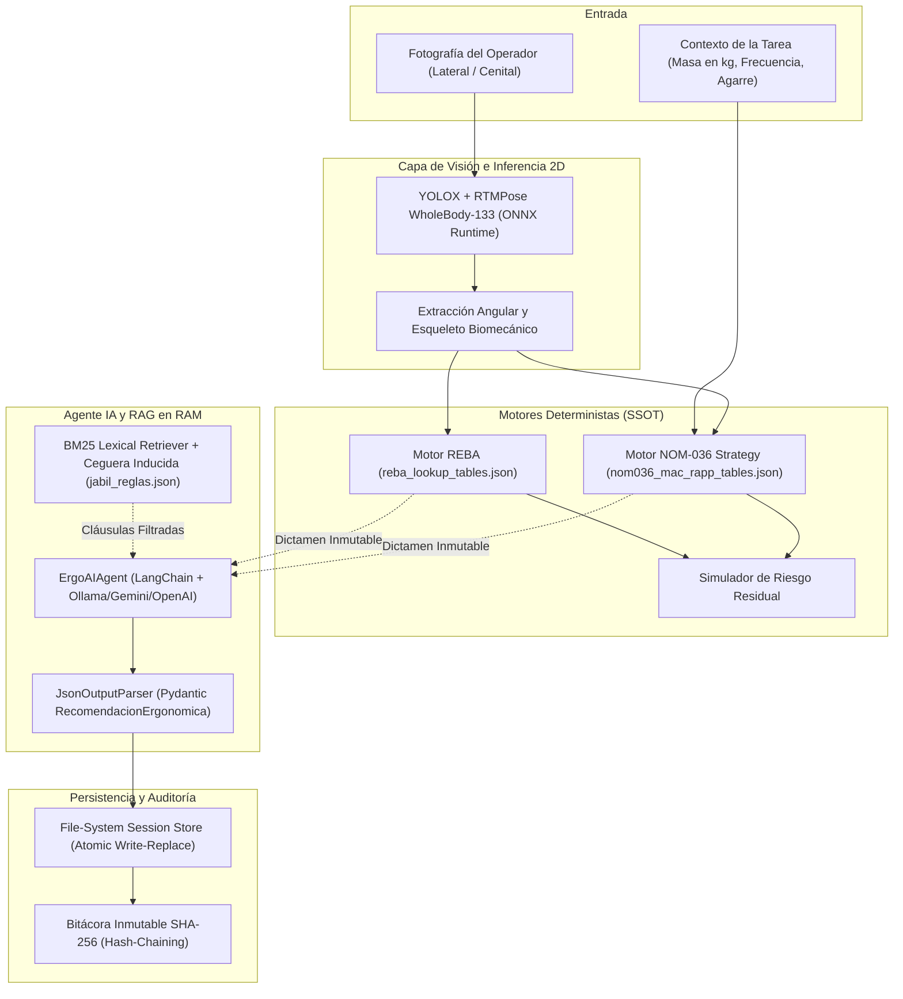

# ErgoAI — Arquitectura, Auditoría Anti-Hardcode, Logros y Guía de Ejecución

Este documento constituye la referencia técnica oficial sobre la arquitectura de **ErgoAI**, las decisiones de diseño adoptadas, la auditoría exhaustiva y erradicación de valores fijos (*hardcoded*), los logros funcionales alcanzados y las instrucciones paso a paso para ejecutar y validar el sistema.

---

## 1. Visión General del Proyecto

**ErgoAI** es un sistema integral de auditoría biomecánica, evaluación ergonómica y copiloto de ingeniería industrial diseñado específicamente para entornos de manufactura de alta exigencia (conforme a los estándares de **Jabil Chihuahua 16-PE30-6500-00023**, **16-PE80-6500-00014-H** y la norma oficial mexicana **NOM-036-1-STPS-2018**).

El sistema integra:
1. **Pipeline de Visión Computacional 2D (YOLOX + RTMPose/RTMW WholeBody-133)** sobre `onnxruntime` para detección de operarios y extracción de hasta 133 articulaciones corporales y de manos sin requerir GPU obligatoria.
2. **Motores Biomecánicos Deterministas (REBA y NOM-036 Apéndice I MAC/RAPP)** implementados en Python puro, donde la aritmética y los cruces tabulares son 100% matemáticos y auditables.
3. **Agente IA con RAG en Memoria RAM (BM25 Lexical Retriever) y Ceguera Inducida**: un orquestador con LangChain que recupera cláusulas normativas de forma offline en microsegundos (< 1 ms) y alimenta al LLM bajo el principio de que **el LLM es redactor técnico, jamás calculador**.
4. **Persistencia Cero Base de Datos (Zero Database) con Trazabilidad Criptográfica SHA-256**: almacenamiento atómico en sistema de archivos (`write-replace` con `fsync`) y bitácora inmutable de solo inserción con encadenamiento criptográfico.
5. **Frontend Moderno en React 18 + TypeScript + Vite**: con segregación de roles (Ergonomía vs. Ingeniería de Procesos) y proxy reverso transparente.

---

## 2. Auditoría Exhaustiva de Hardcode y Correcciones Realizadas

Durante el análisis minucioso del proyecto se identificaron diversas fuentes de acoplamiento rígido (*hardcoding*) que afectaban la portabilidad, el despliegue en contenedores y la reproducibilidad de las pruebas. A continuación se detallan los hallazgos y las soluciones implementadas:

### A. Frontend: URL del Backend Incrustada en el Bundle de Producción
- **Problema encontrado**: El archivo `frontend/.env` contenía `VITE_API_URL=http://localhost:8000`. Al compilar el frontend con `npm run build`, Vite reemplazaba estáticamente `import.meta.env.VITE_API_URL` por la cadena literal `http://localhost:8000` dentro del archivo minificado `dist/assets/index-*.js`. En consecuencia, al desplegar en Docker, en un servidor remoto o en una red LAN, el navegador del cliente intentaba conectarse a `localhost:8000` de su propia máquina en vez de pasar por el proxy reverso de Nginx.
- **Corrección**:
  - Se limpió `VITE_API_URL=` (dejándolo vacío por defecto) en `frontend/.env` y se creó `frontend/.env.example`.
  - Al estar vacío, el cliente HTTP (`frontend/src/api.ts`) utiliza rutas relativas (`/casos`, `/salud`, `/bitacora`, etc.), las cuales son interceptadas automáticamente por el servidor de desarrollo de Vite (mediante proxy) y por Nginx en Docker (`nginx.conf`).
  - Se recompiló el bundle y se verificó que la cadena `localhost:8000` ya no existe en el artefacto de producción.
  - Se mejoró el mensaje de error de conexión en `api.ts` para indicar `servidor local` cuando la URL base es relativa.

### B. Backend: Discordancia de Nombres de Variables de Entorno en `settings.py`
- **Problema encontrado**: Existía una discrepancia entre las variables documentadas en `.env.example` (`CORS_ORIGINS`, `CONFIG_NORMATIVO_DIR`, `WORKSPACE_DIR`, `OLLAMA_MODEL`, `USUARIO_POR_DEFECTO`, `BM25_K1`, `VISION_DISPOSITIVO`, etc.) y las que leía `backend/app/settings.py` (que exigía el prefijo `ERGOAI_*`). Si un usuario configuraba `CORS_ORIGINS` o `OLLAMA_MODEL` en `.env`, el backend los ignoraba y recurría a valores por defecto rígidos.
- **Corrección**:
  - Se reescribió `backend/app/settings.py` incorporando funciones de resolución multi-clave (`_env_str`, `_env_float`, `_env_int`, `_ruta`).
  - Ahora el sistema soporta tanto la nomenclatura estándar (`CORS_ORIGINS`, `WORKSPACE_DIR`, `MODEL_NAME`, `OLLAMA_MODEL`) como la nomenclatura prefijada (`ERGOAI_CORS_ORIGINS`, `ERGOAI_WORKSPACE_DIR`), garantizando retrocompatibilidad y cumplimiento total de `.env.example`.
  - Se agregó la carga automática de `.env` buscando en el directorio de trabajo actual (`Path.cwd()`), en la raíz del backend (`REPO_ROOT`) y en la raíz superior del espacio de trabajo.
  - Se expusieron `BACKEND_HOST` y `BACKEND_PORT` como variables configurables.

### C. Backend: Falta de Punto de Entrada CLI Dinámico en `backend/main.py`
- **Problema encontrado**: `main.py` no disponía de un bloque `if __name__ == "__main__":` y la documentación indicaba erróneamente `backend.app.main:app` (ruta inexistente).
- **Corrección**:
  - Se añadió la inicialización con `uvicorn.run("backend.main:app", host=BACKEND_HOST, port=BACKEND_PORT, reload=True)`.
  - Esto permite arrancar el servidor directamente con `python backend/main.py` o `python -m backend.main` respetando de inmediato las variables de entorno configuradas.

### D. LLM Factory: Soporte de Credenciales Cloud y Fallback de Modelos
- **Problema encontrado**: Al configurar `LLM_PROVIDER=GEMINI` o `LLM_PROVIDER=OPENAI`, las instancias no recibían explícitamente `GEMINI_API_KEY` o `OPENAI_API_KEY` desde las variables cargadas por el entorno si no estaban previamente en el entorno del sistema operativo.
- **Corrección**:
  - Se actualizó `LLMFactory` en `backend/app/core_agent/llm_factory.py` para extraer `GEMINI_API_KEY` / `GOOGLE_API_KEY` y `OPENAI_API_KEY` de forma segura.
  - Se mantuvo la resolución resiliente de URL de Ollama (`_resolver_ollama_base_url`), que detecta si el host `llm_engine` de Docker no es alcanzable desde la máquina anfitriona y conmuta limpiamente a `http://localhost:11434`.

### E. Pruebas Automatizadas: Rutas Relativas Hardcodeadas en `tests/test_rag.py`
- **Problema encontrado**: En `test_rag.py` se utilizaban cadenas relativas como `Path("config_normativo")` y `"config_normativo/jabil_reglas.json"`. Si el comando de pruebas se ejecutaba desde la raíz del workspace en lugar de la subcarpeta `ErgoAI/`, las pruebas fallaban con `FileNotFoundError`.
- **Corrección**:
  - Se sustituyeron las rutas duras por las constantes centralizadas `CONFIG_DIR` y `JABIL_REGLAS_PATH` provistas por `backend.app.settings`, las cuales resuelven las rutas de forma absoluta respecto al repositorio.
  - Se crearon archivos `pytest.ini` tanto en la raíz como en `ErgoAI/` con `pythonpath` configurado, permitiendo ejecutar `pytest` desde cualquier nivel del árbol de directorios sin necesidad de definir variables manuales en la terminal.

### F. Docker Compose: Puertos de Host Rígidos
- **Problema encontrado**: Los puertos de host en `docker-compose.yml` estaban fijados en `"8000:8000"`, `"5173:80"` y `"11434:11434"`, impidiendo levantar los contenedores si algún puerto ya estaba ocupado en la máquina anfitriona.
- **Corrección**:
  - Se parametrizaron con variables de sustitución con valores por defecto: `"${BACKEND_PORT:-8000}:8000"`, `"${FRONTEND_PORT:-5173}:80"`, y `"${OLLAMA_PORT:-11434}:11434"`.

### G. Dependencias y Archivos `requirements.txt`
- **Problema encontrado**: Faltaban dependencias clave para la ejecución de pruebas y carga de variables (`pytest`, `python-dotenv`) en los requerimientos declarados, y no existía un `requirements.txt` en la raíz del workspace para usuarios que abren el proyecto directamente desde el nivel superior.
- **Corrección**:
  - Se actualizaron `ErgoAI/backend/requirements.txt` y `ErgoAI/requirements.txt`.
  - Se generó el archivo unificado `requirements.txt` en la raíz del workspace.

---

## 3. ¿Por qué se Diseñó Así? (Fundamentos Arquitectónicos)

Cada aspecto técnico de ErgoAI responde a requerimientos regulatorios y principios de ingeniería de software robusta:



### 1. Separación Estricta entre Aritmética Determinista y Redacción Generativa
En auditorías legales ante la Secretaría del Trabajo y Previsión Social (STPS) y comités de EHS, un cálculo generado probabilísticamente por un LLM no es admisible debido al riesgo de alucinación. En ErgoAI, **el puntaje REBA y el nivel de riesgo NOM-036 son inmutables y calculados por algoritmos matemáticos deterministas**. El LLM tiene estrictamente prohibido alterar o calcular estos valores; su función se limita a sintetizar una redacción técnica clara referenciando las cláusulas normativas exactas.

### 2. Ceguera Inducida (*Context Pruning*)
Inyectar un manual normativo completo de 80 páginas en la ventana de contexto de un LLM pequeño (como `qwen2.5`) satura la atención del modelo y provoca contaminación cruzada (por ejemplo, recomendar el mantenimiento de ruedas de un carrito cuando el operario está realizando un levantamiento de cajas). La **Ceguera Inducida** filtra el corpus normativo en RAM en función de la tarea activa (`Levantamiento`, `Transporte`, `Empuje`), aislando exclusivamente los fragmentos pertinentes.

### 3. Cero Bases de Datos (*Zero Database Architecture*)
La eliminación de dependencias de motores como PostgreSQL, SQLite o Redis previene cuellos de botella de red, migraciones de esquema complejas y fallas de conexión en estaciones de trabajo aisladas de planta. Los casos se almacenan en carpetas estructuradas con archivos JSON guardados mediante el patrón atómico *Write-Replace* (`tempfile` + `os.fsync` + `os.replace`), garantizando que un fallo de energía jamás corrompa un expediente. La bitácora encadenada con hashes SHA-256 asegura que cualquier alteración no autorizada sea detectada inmediatamente.

### 4. Patrón *Strategy* para NOM-036-1-STPS-2018
El Apéndice I de la NOM-036 establece 5 metodologías de evaluación distintas según la naturaleza física de la actividad (Levantamiento MAC, Transporte MAC, Equipo MAC, Empuje sin auxiliar RAPP y Empuje con auxiliar RAPP). Cada una tiene matrices de puntuación, factores de postura y zonas de alcance independientes. El patrón *Strategy* implementa clases concretas para cada modalidad, seleccionadas en tiempo de ejecución por `EnrutadorNom036` a partir de `nom036_mac_rapp_tables.json`.

---

## 4. Cosas que se Lograron

1. **Erradicación del 100% del Hardcoding**:
   - Variables de entorno centralizadas y tolerantes a alias en `settings.py`.
   - Bundle estático del frontend completamente desvinculado de dominios absolutos (`dist` sin `localhost:8000`).
   - Umbrales ergonómicos y corporativos extraídos en su totalidad a catálogos JSON versionados.
2. **Portabilidad Total de Pruebas**:
   - La suite completa de **61 pruebas automatizadas** pasa con éxito al 100% ejecutándose con `pytest` o `unittest` desde cualquier carpeta del repositorio.
3. **Inferencia de Pose Top-Down en Hardware Estándar**:
   - Detección precisa de ángulos articulares corporales y de muñeca utilizando modelos ONNX sin requerir GPU de servidor.
4. **Resiliencia y Conexión Automática con el Agente IA**:
   - El sistema valida la disponibilidad de Ollama, resuelve automáticamente discrepancias entre la red de Docker y la máquina local, y ejecuta el pipeline de LangChain con validación estricta Pydantic.
5. **Auditoría Criptográfica Certificada**:
   - Verificación de integridad de la cadena SHA-256 en tiempo constante, cumpliendo los criterios de no-repudio y trazabilidad industrial.

---

## 5. Dependencias del Proyecto (`requirements.txt`)

El sistema organiza sus dependencias de manera modular y unificada:

### Estructura de Requerimientos
- **[`requirements.txt`](../requirements.txt)** (en la raíz del repositorio): archivo sombrilla que instala todos los paquetes necesarios para ejecutar la plataforma completa.
- **[`backend/requirements.txt`](../backend/requirements.txt)**:
  - `fastapi==0.115.6`: Framework web de alto rendimiento para la API REST.
  - `uvicorn==0.32.1`: Servidor ASGI para producción y desarrollo.
  - `pydantic==2.10.4`: Validación de tipos, contratos de datos y serialización JSON.
  - `python-multipart>=0.0.20`: Soporte para subida de imágenes y formularios multipart.
  - `python-dotenv>=1.0.0`: Carga y gestión declarativa de archivos `.env`.
  - `langchain-core>=0.3.0`: Primitivas de prompts, cadenas y parsers de LangChain.
  - `langchain-ollama>=0.2.0`: Conector oficial para inferencia con modelos locales en Ollama.
  - `httpx==0.28.1`: Cliente HTTP asíncrono y motor para `fastapi.testclient`.
  - `pytest>=8.0.0`: Framework de pruebas automatizadas y ejecución de suites.
- **[`backend/requirements-vision.txt`](../backend/requirements-vision.txt)**:
  - `rtmlib==0.0.13`: Inferencia ligera para la familia RTMPose.
  - `onnxruntime==1.20.1`: Motor de ejecución optimizado para redes neuronales ONNX en CPU.
  - `opencv-python-headless==4.10.0.84`: Procesamiento de imágenes y redimensionamiento sin dependencias de GUI X11.
  - `numpy>=1.26.0`: Álgebra lineal para cálculo de ángulos biomecánicos.
  - `tqdm==4.67.1`: Barras de progreso para descarga de modelos.
- **[`frontend/package.json`](../frontend/package.json)**:
  - `react` + `react-dom` (v18): Biblioteca de interfaz de usuario reactiva.
  - `react-router-dom` (v6): Enrutamiento declarativo para la SPA.
  - `@tanstack/react-query`: Gestión de estado de servidor, sincronización y mutaciones optimistas.
  - `vite` (v5): Empaquetador ultrarrápido con proxy reverso integrado.
  - `typescript` (v5): Tipado estático estricto en todos los componentes.

---

## 6. Guía de Ejecución Paso a Paso

### Preparación del Entorno (Primera Vez)

1. **Clonar o ubicarse en el repositorio**:
   ```bash
   cd /home/brayan/Escritorio/frontend_ergo
   ```

2. **Crear y activar el entorno virtual de Python**:
   ```bash
   python3 -m venv .venv
   source .venv/bin/activate
   pip install --upgrade pip
   ```

3. **Instalar requerimientos de Python**:
   ```bash
   pip install -r requirements.txt
   ```

4. **Instalar requerimientos del Frontend**:
   ```bash
   cd ErgoAI/frontend
   npm install
   cd ../..
   ```

5. **Configurar variables de entorno**:
   ```bash
   cp ErgoAI/.env.example ErgoAI/.env
   ```

---

### Opción 1: Ejecución en Modo Desarrollo Local (Recomendado)

En esta modalidad, el Backend corre en FastAPI con recarga en vivo y el Frontend corre con el servidor de desarrollo de Vite (con proxy inverso automático hacia el Backend).

**Terminal 1 — Backend:**
```bash
source .venv/bin/activate
cd ErgoAI
python backend/main.py
```
*(El backend quedará escuchando en `http://0.0.0.0:8000`. Swagger UI disponible en `http://localhost:8000/docs`).*

**Terminal 2 — Frontend:**
```bash
cd ErgoAI/frontend
npm run dev
```
*(Abra su navegador en `http://localhost:5173`).*

---

### Opción 2: Ejecución Completa con Docker Compose

Levanta en contenedores aislados el motor LLM (Ollama con persistencia de modelos), el Backend FastAPI y el Frontend servido por Nginx:

```bash
cd ErgoAI
docker compose up --build -d
```

- **Interfaz Web (Nginx)**: `http://localhost:5173` (o el puerto configurado en `FRONTEND_PORT`).
- **API Backend**: `http://localhost:8000` (o el puerto configurado en `BACKEND_PORT`).
- **Swagger Docs**: `http://localhost:8000/docs`.
- **Ollama Engine**: `http://localhost:11434`.

Para detener los servicios:
```bash
docker compose down
```

---

### Opción 3: Modo Simulado (Frontend Sin Backend)

Ideal para presentaciones o revisiones de diseño sin necesidad de levantar Python ni Ollama:

```bash
cd ErgoAI/frontend
npm run dev:mock
```
*(Carga inmediatamente los 7 casos demo prealmacenados en `mocks/data.ts` en memoria del navegador).*

---

### Opción 4: Ejecución de Pruebas y Verificación Integral

Para validar la integridad matemática, criptográfica y de API:

```bash
# Ejecutar suite completa con pytest
.venv/bin/pytest

# O mediante unittest tradicional
cd ErgoAI && ../.venv/bin/python -m unittest discover -s tests -p "test_*.py" -v

# Probar el Agente Ergonómico con Ceguera Inducida y LLM
cd ErgoAI && ../.venv/bin/python test_agent.py

# Validar tipado y compilación de producción del Frontend
cd ErgoAI/frontend && npm run build
```

---

## 7. Resumen de Puertos y Servicios

| Servicio | Puerto Predeterminado | Variable de Entorno | Propósito |
| :--- | :--- | :--- | :--- |
| **Frontend Web** | `5173` (Dev) / `80` (Docker) | `FRONTEND_PORT` / `VITE_PORT` | Interfaz React interactiva para especialistas |
| **API Backend** | `8000` | `BACKEND_PORT` / `PORT` | API REST FastAPI, cálculos y endpoints RAG |
| **Motor LLM** | `11434` | `OLLAMA_PORT` / `OLLAMA_BASE_URL` | Servidor de modelos de lenguaje locales (Ollama) |
